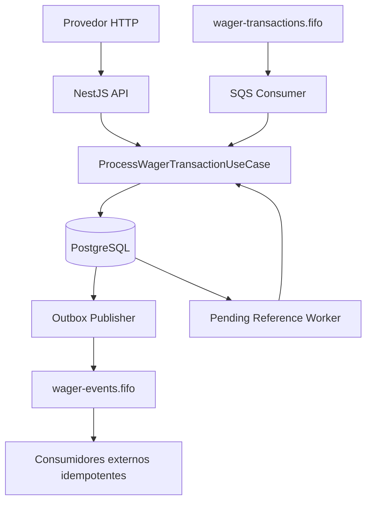

# ARCHITECTURE — Distributed Wagering Wallet

## 1. Objetivo e prioridades

O serviço processa operações financeiras de apostas recebidas por HTTP ou AWS SQS, inclusive sob concorrência, reentrega, reinício dos processos e chegada fora de ordem. As prioridades de projeto são:

1. **Correção financeira:** nunca permitir saldo negativo, lost update ou dupla movimentação.
2. **Idempotência persistente:** operações e mensagens repetidas produzem um único efeito de negócio.
3. **Atomicidade:** nenhuma transação deixa carteira, ledger, Inbox e Outbox parcialmente confirmados.
4. **Auditoria:** ledger append-only e reconciliação independente do saldo materializado.
5. **Disponibilidade operacional:** recuperação de falhas e múltiplos processos sem estado crítico compartilhado em memória.

A entrega utiliza Bun 1.x, TypeScript estrito, NestJS, PostgreSQL, MikroORM, AWS SDK SQS FIFO no LocalStack e Docker Compose. O banco é a **fonte de verdade**; FIFO organiza e otimiza a entrega, mas não substitui controles transacionais.

## 2. Visão de arquitetura



O fluxo de processamento financeiro é centralizado em `ProcessWagerTransactionUseCase`. HTTP e SQS utilizam o mesmo caso de uso; adaptadores não possuem lógica independente de débito/crédito.

As responsabilidades são separadas em:

| Camada | Responsabilidades |
| --- | --- |
| Domínio | `Money`, `Wallet`, `WagerTransaction`, `WalletLedgerEntry`, entidades de Inbox/Outbox, eventos e invariantes |
| Aplicação | Casos de uso de wallet, transação e reconciliação; contratos/ports |
| Infraestrutura | MikroORM/PostgreSQL, SQS, Outbox Publisher, Consumer, worker de referência e observabilidade |
| Apresentação | Controllers HTTP, validação, semântica dos códigos HTTP |

O domínio não usa `number` para valores monetários nem depende de DTOs HTTP ou classes do ORM para suas regras.

## 3. Modelo financeiro

### 3.1 Money

- `Money` é um value object imutável baseado em `Decimal` (`decimal.js`).
- Representação externa: `{ "amount": "25.00", "currency": "BRL" }`.
- Precisão fixa de duas casas decimais; rejeição de `NaN`, `Infinity`, notação científica, valores inválidos e valores negativos em operações de entrada.
- Operações entre moedas diferentes são inválidas.
- O PostgreSQL armazena montantes em `NUMERIC(20,2)`; dinheiro não passa por `float`/`double`.

### 3.2 Wallet (aggregate root)

`Wallet` identifica `(playerId, currency)`, mantém saldo materializado e versão. A versão inicia em 1 na criação e aumenta apenas em movimentações financeiras efetivas. Abertura com saldo positivo cria uma operação `OPENING` e seu crédito no ledger, no mesmo commit.

Invariantes: saldo nunca negativo; moeda compatível; movimentação processada que altera saldo produz exatamente uma entrada do ledger; `LOSS` e `REJECTED` não criam entrada.

### 3.3 Operações

| Tipo | Efeito financeiro | Restrições |
| --- | --- | --- |
| `OPENING` | CREDIT | Apenas interno, durante abertura da wallet |
| `BET` | DEBIT | Rejeitar por saldo insuficiente |
| `WIN` | CREDIT | Validação de carteira, jogador, moeda e provedor |
| `LOSS` | Sem mudança | Transação processada, sem ledger e sem evento de saldo |
| `REFUND` | CREDIT | Reverte uma `BET` processada, mesmo valor |
| `ROLLBACK` | Inverso da referência | Reverte BET, WIN ou REFUND processada |

Referências de reversões são resolvidas por `(providerId, referenceExternalTransactionId)` e devem ser compatíveis com carteira, jogador, rodada, provedor, moeda e valor. As reversões de referências já revertidas são bloqueadas pela lógica de domínio e por índices únicos parciais no schema. Como decisão adicional, o schema não permite que REFUND e ROLLBACK processados disputem a mesma referência original.

Estados: `PENDING`, `PENDING_REFERENCE`, `PROCESSED`, `REJECTED`, `FAILED`. Estados terminais não voltam a transições ativas. Rejeições possuem `failureCode` estável (por exemplo, saldo insuficiente, referência inexistente, referência já revertida e insuficiência de saldo na reversão).

## 4. Ledger e reconciliação

`wallet_ledger_entries` é o histórico monetário append-only: direção (`DEBIT`/`CREDIT`), montante, saldo anterior, saldo posterior e referência à operação e à carteira. Constraints SQL verificam a aritmética e não negatividade; índices evitam múltiplas entradas para a mesma operação/carteira; FKs validam referências. Triggers impedem **UPDATE, DELETE e TRUNCATE**.

O ledger é **de lançamentos por wallet**, não contabilidade de partidas dobradas (*double-entry*); esta é uma limitação de escopo explicitamente permitida pelo desafio.

A reconciliação executa um `SELECT` que compara o saldo materializado ao resultado de `SUM(CREDIT) - SUM(DEBIT)`, utilizando operações `NUMERIC` do PostgreSQL. Ler saldo e ledger na mesma instrução evita comparar snapshots incompatíveis durante escrita concorrente. A resposta contém `storedBalance`, `calculatedBalance`, `difference`, `consistent` e `checkedEntries`.

Uma divergência gera log e métrica, **não correção silenciosa**. Uma reconciliação consistente não substitui auditoria de todas as invariantes, mas detecta diferenças no saldo acumulado.

## 5. Transações SQL e concorrência

### 5.1 Unidade de serialização

A unidade de concorrência é **a wallet**, não todo o sistema. O caso de uso utiliza uma transação do PostgreSQL e um bloqueio pessimista por carteira (`SELECT ... FOR UPDATE`), além de checagens de versão/constraints aplicáveis. Outras carteiras podem avançar concorrentemente; modificações da mesma carteira são serializadas.

```mermaid
sequenceDiagram
    participant A as Instância A
    participant B as Instância B
    participant DB as PostgreSQL
    A->>DB: BEGIN; SELECT wallet FOR UPDATE
    B->>DB: BEGIN; SELECT mesma wallet FOR UPDATE
    Note over B,DB: B aguarda lock de A
    A->>DB: Debita BET + ledger + outbox
    A->>DB: COMMIT
    DB-->>B: Lock disponível, saldo atualizado
    B->>DB: Reavalia saldo sob lock
    B->>DB: REJECTED por saldo insuficiente
    B->>DB: COMMIT
```

Exemplo testado: saldo `100.00`, duas BETs independentes de `80.00` em paralelo: uma `PROCESSED`, a outra `REJECTED`, saldo `20.00`, um único ledger DEBIT. A aplicação não utiliza lock global compartilhado entre wallets.

### 5.2 Atomicidade

O commit financeiro abrange, conforme a operação:

1. Registro e decisão da `wager_transactions`;
2. Alteração de `wallets.balance` e incremento de versão, se houver movimento;
3. Entrada em `wallet_ledger_entries`, se houver movimento;
4. Registro de Inbox/processedAt, se o comando vier do SQS;
5. Enfileiramento do(s) evento(s) em `outbox_messages`.

A ordem de persistência é interna à transação: **nenhum evento é enviado ao SQS antes do COMMIT**. Testes reais injetaram falhas de gravação no ledger e na Outbox e comprovaram rollback de toda a operação, seguido de reentrega/processamento corretos.

## 6. Idempotência

### 6.1 Identidade da operação

Duas chaves únicas no PostgreSQL identificam a operação por `(providerId, externalTransactionId)` e `(providerId, idempotencyKey)`. O header HTTP `Idempotency-Key` é obrigatório; a mensagem SQS carrega seu próprio `idempotencyKey`. A composição recomendada ao provedor é `${providerId}:${externalTransactionId}`.

O `payloadHash` é SHA-256 de JSON canônico dos campos de negócio, com chaves ordenadas. Metadados de transporte não definem o conteúdo de negócio. Uma nova entrega idêntica encontra a transação previamente criada e retorna o resultado persistido, incluindo saldo observado historicamente; reutilizar a mesma chave com dados diferentes é **conflito**, não replay.

### 6.2 Identidade da mensagem SQS

A Inbox mantém `(consumerName, messageId)` único, com `payloadHash` e `processedAt`. O par é independente da identidade financeira: uma mesma operação pode chegar por mensagens de transporte diferentes e ainda ser deduplicada pela transação financeira. O registro da Inbox é confirmado **junto** ao resultado financeiro.

A deduplicação SQS FIFO possui uma janela limitada e não é usada como fonte de verdade para efeitos financeiros.

## 7. Mensageria, Outbox e falhas

### 7.1 SQS Consumer

- Fila: `wager-transactions.fifo`; agrupamento por `walletId` para manter ordenação local.
- `ReceiveMessage`, validação do envelope, chamada ao mesmo caso de uso da API.
- `DeleteMessage` **somente depois** da confirmação do commit.
- Erro transitório: mensagem sem ACK, visibilidade alterada e reentrega com backoff.
- Mensagem inválida/conflito irrecuperável: não ACK; após limite de entregas, DLQ (`maxReceiveCount = 5` no Compose de demonstração).
- Heartbeat renova a visibilidade em processamento, reduzindo entregas concorrentes prematuras.
- SIGTERM encerra o ciclo após o trabalho em curso; morte forçada ainda é tratada pela Inbox persistente.

**Crash entre commit e ACK:** o PostgreSQL já contém a transação e a Inbox. Ao expirar a visibilidade, outra instância recebe o mesmo comando, identifica o replay e ACK sem segundo débito. Esse cenário foi exercitado com subprocessos Bun separados e ponto de falha isolado de teste.

### 7.2 Transactional Outbox

O caso de uso grava `outbox_messages` no mesmo commit da operação financeira. O publisher seleciona eventos vencidos com `FOR UPDATE SKIP LOCKED`, claim token/lease e agendamento de retry. Dois publishers podem trabalhar sobre a mesma tabela sem depender de estado partilhado em memória.

Eventos: `WagerTransactionProcessed` (inclusive LOSS), `WagerTransactionRejected`, `WagerTransactionPendingReference` e `WalletBalanceChanged` (apenas quando o saldo muda). Envelope inclui `eventId`, `eventType`, `aggregateId`, `correlationId`, `causationId` opcional, `occurredAt`, `version` e `data` serializável com valores monetários em string.

**Garantia da Outbox:** evento confirmado não depende da disponibilidade imediata do SQS para sobreviver. **Limite da garantia:** se o SQS aceita o envio e o processo morre antes de marcar `published_at`, a mesma mensagem poderá ser publicada novamente. Consumidores dos eventos precisam deduplicar pelo `eventId` de maneira persistente. Não se promete *exactly-once delivery*.

### 7.3 Referências fora de ordem

REFUND/ROLLBACK recebido antes da referência é persistido como `PENDING_REFERENCE`, com ACK da solicitação e evento de pendência. O `PendingReferenceWorker` consulta `next_reference_attempt_at` e realiza novas tentativas com backoff exponencial, limitado a 300 segundos entre reavaliações. O limite adotado é **8 tentativas de reavaliação ou TTL de 24 horas**; no esgotamento, a transação passa para `REJECTED` por referência não encontrada, com evento correspondente e sem movimentação de saldo.

Esse processo persiste as tentativas no PostgreSQL, sobrevive ao reinício e não duplica lançamentos. Foram testados REFUND antes de BET e ROLLBACK antes de WIN, incluindo reinicialização do worker.

## 8. Constraints e migrations

O schema aplica proteções além das verificações do código:

- `CHECK` do saldo da wallet não negativo e versão positiva.
- `NUMERIC(20,2)` e moeda válida nas tabelas financeiras.
- Unicidade de `(player_id, currency)` em `wallets`.
- Unicidade de transação externa e chave de idempotência por provedor.
- Unicidade de Inbox `(consumer_name, message_id)`.
- Unicidade de ledger `(wallet_id, transaction_id)`.
- FKs do ledger para carteira e transação e da referência interna de reversões.
- Índices parciais para impedir reversões processadas duplicadas ou concorrentes da mesma referência.
- Triggers de UPDATE, DELETE e TRUNCATE do ledger.

As migrations são versionadas, com `up()` e `down()`. A auditoria executada durante o desenvolvimento criou um banco descartável e verificou `migration:up → 7 testes → migration:down --to 0 → migration:up → 7 testes`, totalizando **14 testes aprovados** após a correção da reversibilidade de uma migration anterior.

Aplicar `migration:down` a um banco com dados reais é operação destrutiva e **não faz parte do procedimento de produção**.

## 9. Autenticação e fronteira de confiança

**Decisão de timebox:** não foi integrado um Identity Provider externo nesta entrega. O desafio permite essa decisão e não atribui pontos a uma implementação de autenticação artesanal. Consequentemente, **os endpoints financeiros não devem ser expostos publicamente como estão**.

Ponto de extensão proposto (arquivo adicional `src/application/ports/provider-identity.port.ts`): contrato `ProviderIdentityPort` para resolver a identidade autenticada do provedor e suas permissões sem acoplar o domínio ao framework HTTP.

Para produção, o desenho seria:

1. Integrar um Identity Provider OIDC (por exemplo Keycloak ou Zitadel).
2. Validar assinatura, issuer, audience, expiração e escopos do JWT no Guard de entrada.
3. Resolver `providerId` da identidade autenticada e validar que corresponde à operação; não confiar em um `providerId` enviado livremente no body.
4. Isolar autorização por carteira/jogador/provedor conforme vínculos do domínio.
5. Manter `/health/live` e `/health/ready` abertos ao monitoramento; restringir `/metrics` por rede ou autenticação de observabilidade.
6. Tratar SQS como canal interno com políticas IAM, mantendo validações de identidade de negócio mesmo no payload recebido.

**Importante:** adicionar um contrato de port não ativa autenticação por si só. Esta decisão e seu risco precisam ser declarados na apresentação.

## 10. Observabilidade

- Logs JSON do NestJS e logs estruturados de SQS/Outbox/reconciliação, com IDs de correlação quando disponíveis.
- `GET /health/live`: processo em execução.
- `GET /health/ready`: consulta PostgreSQL e verifica URLs das três filas (entrada, eventos e DLQ); degrada para HTTP 503.
- Métricas Prometheus de processamento por status, duplicatas, retries, conflitos de versão, duração, reconciliação, DLQ e atraso da Outbox.
- Labels possuem cardinalidade controlada: nunca usar UUID de wallet/transação/mensagem como label.

**Limitações operacionais:** contadores de processos diferentes não se somam automaticamente no endpoint `/metrics` da API; a instrumentação de produção exige um scrape por instância/worker, agregação ou solução de métricas distribuídas. Métricas de tamanho de DLQ do SQS são aproximadas. Algumas falhas de dependência podem exceder tempos esperados se o banco não estiver com timeouts completos configurados.

## 11. Estratégia de testes e evidências

| Suite | Evidência principal |
| --- | --- |
| Unitários de Money/Wallet/domínio | Precisão e invariantes de negócio |
| `sqs-consumer.integration.test.ts` | Inbox, redelivery, DLQ, operações financeiras |
| `reconciliation.integration.test.ts` | Divergência no banco isolado sem correção silenciosa |
| `http-concurrency.test.ts` | Três processos HTTP, 50 BETs iguais, duas BETs de 80, wallets independentes |
| `parallel-outbox.integration.test.ts` | Dois publishers e eventos recuperáveis no SQS |
| `sqs-workers-recovery.integration.test.ts` | Três consumidores e crash após commit antes do ACK |
| `pending-reference-recovery.integration.test.ts` | Reversões fora de ordem e reinicialização |
| `financial-atomicity.integration.test.ts` | Falha no ledger/Outbox e rejeição de referência esgotada |
| `schema-constraints.integration.test.ts` + `run-schema-audit.ps1` | Constraints, índices, triggers, FKs e 14 verificações com migrations reversíveis |

Todas as suítes de injeção de falha exigem banco isolado e filas temporárias. O critério de sucesso financeiro é o saldo da wallet coincidir com o saldo reconstruído pelo ledger e existir no máximo um lançamento por transação financeira efetiva.

## 12. Trade-offs e limitações conhecidas

| Escolha | Benefício | Custo / limitação |
| --- | --- | --- |
| Lock pessimista por wallet | Sem lost update na hot wallet | Operações concorrentes da mesma wallet aguardam; throughput limitado por wallet |
| PostgreSQL como fonte de verdade | Idempotência entre instâncias e após reinício | Maior carga transacional e necessidade de índices/monitoramento |
| Ledger imutável por wallet | Auditoria e reconciliação confiáveis | Não é modelo contábil double-entry completo |
| Inbox + Outbox | Recuperação robusta após crash | Mais tabelas, estados, leases e rotina de limpeza/retention ainda não operacionalizada |
| SQS FIFO | Ordenação por wallet e integração assíncrona | Deduplicação temporária, throughput por grupo e entrega at-least-once |
| `PENDING_REFERENCE` com limite | Não rejeita imediatamente mensagens fora de ordem | Depende de worker e políticas de retry/TTL; operação pode terminar em REJECTED se referência não chegar |
| Cursor Base64URL | Paginação estável por keyset | Cursor não é assinado; não constitui autorização nem snapshot histórico imutável |
| Métricas locais | Baixa complexidade no desafio | Monitoramento multi-instância demanda scraping/agregação adicionais |
| Auth delegada ao IdP (não implementada) | Mantém foco na correção financeira | Impede exposição segura da API pública antes da integração de autenticação/autorização |

### Próximos aprimoramentos fora do escopo da entrega

- Endurecimento de segurança, segredos gerenciados e permissões IAM reais.
- OpenTelemetry, traces distribuídos e dashboards/alertas.
- Scrape por worker/instância com agregação de métricas.
- Política operacional de retenção/arquivamento para Inbox, Outbox e ledger.
- Testes adicionais de carga prolongada, degradação de dependências e recuperação operacional.
- Pipeline CI para compilar, iniciar containers e executar as suítes isoladas.

## 13. Como reproduzir

Os comandos de setup, Compose, exemplos HTTP, configuração SQS, execução das suítes e auditoria de migrations estão em [README.md](./README.md).
